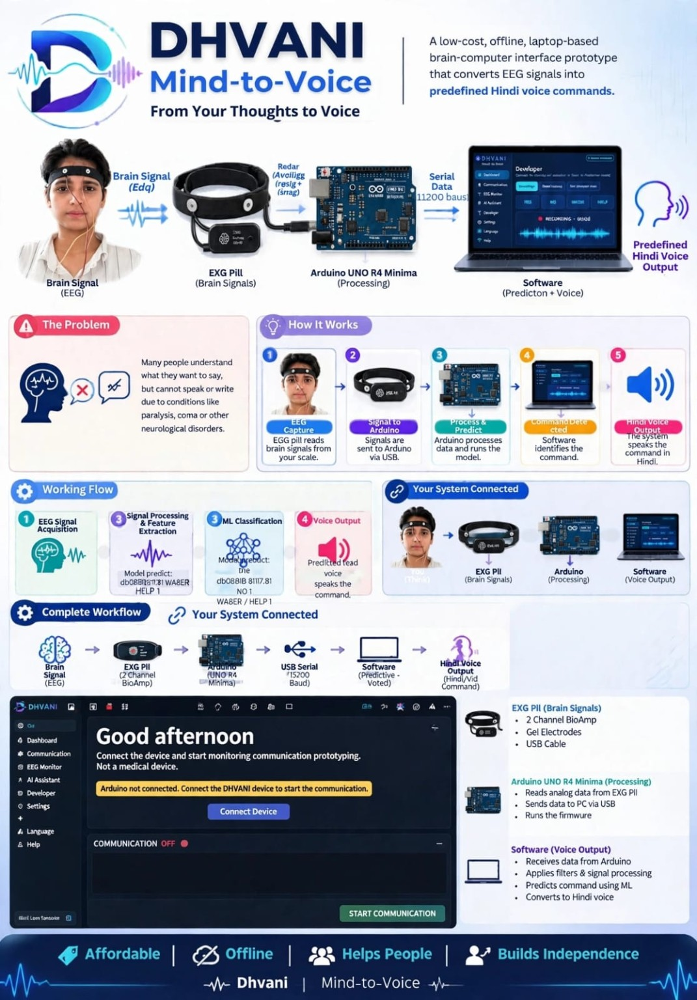

# 🧠 DHVANI – Mind-to-Voice

### From Your Thoughts to Voice

**DHVANI** is a low-cost, offline, laptop-based EEG assistive-communication prototype that converts brain-signal patterns into predefined Hindi voice commands.

**Developer:** T.T.S

---

## 📸 Project Overview



---

## 💡 About the Project

DHVANI combines **EEG signal acquisition, signal processing, machine learning, and voice output** to create a simple communication system.

The system recognizes a set of predefined mental commands such as:

- ✅ YES
- ❌ NO
- 💧 WATER
- 🆘 HELP

The recognized command is converted into **Hindi voice output**, providing an accessible communication interface.

---

## ⭐ Key Features

- 🧠 EEG signal acquisition using BioAmp EXG
- 🔌 Arduino UNO R4 Minima integration
- ⚡ Real-time signal processing
- 🤖 Machine Learning-based command classification
- 🗣️ Hindi voice output
- 💻 Offline laptop-based operation
- 🎯 Simple predefined command system
- 📊 EEG waveform monitoring
- 💾 Recording and dataset management
- 🔄 Live prediction and voice generation
- 🌐 User-friendly web interface
- 🤝 Designed to support accessible communication

---

## 🔗 System Pipeline

```text
BioAmp EXG
     ↓
EEG Signal
     ↓
Arduino UNO R4 Minima
     ↓
USB Serial – 115200 Baud
     ↓
Python Backend
     ↓
Signal Preprocessing
     ↓
2-Second Window
     ↓
Feature Extraction
     ↓
Machine Learning Model
     ↓
Command Mapping
     ↓
Hindi Voice Output
```

---

## 🛠️ Technology Stack

### Hardware

- BioAmp EXG
- EEG Electrodes
- Arduino UNO R4 Minima
- USB Connection

### Software

- Python
- FastAPI
- NumPy
- SciPy
- Scikit-learn
- Joblib
- PySerial
- Pydantic
- HTML
- CSS
- JavaScript
- WebSocket
- REST API

### Machine Learning

DHVANI uses a **Random Forest classification model** for recognizing predefined EEG command patterns.

---

## 📂 Project Structure

```text
DHVANI SOFTWARE/
│
├── dhvani_eeg/
│   └── dhvani_eeg.ino
│
├── backend/
│   ├── app.py
│   ├── model_service.py
│   └── pipeline.py
│
├── data/
│   └── recordings/
│
├── models/
│   └── prod/
│
├── frontend/
│   └── index.html
│
├── assets/
│   └── dhvani-overview.png
│
├── README.md
└── .gitignore
```

---

## ⚙️ How It Works

### 1. EEG Signal Acquisition

The BioAmp EXG captures EEG signals through the connected electrodes.

### 2. Arduino Processing

The Arduino UNO R4 Minima receives the analog signal and sends the data to the computer through USB serial communication.

### 3. Signal Processing

The backend processes the incoming EEG data using:

- DC removal
- 0.5–40 Hz band-pass filtering
- 50 Hz notch filtering
- Per-channel normalization

### 4. Feature Extraction

The system creates features from the processed EEG signal using statistical measurements and frequency-band information.

### 5. Machine Learning

A Random Forest model classifies the processed signal into one of the predefined commands.

### 6. Voice Output

The recognized command is mapped to Hindi speech and played through the browser.

---

## 🚀 Getting Started

### 1. Clone the Repository

```bash
git clone https://github.com/YOUR-USERNAME/DHVANI.git
cd DHVANI
```

### 2. Create Virtual Environment

```bash
python -m venv .venv
```

### Windows

```bash
.venv\Scripts\activate
```

### 3. Install Dependencies

```bash
pip install -r requirements.txt
```

### 4. Start the Backend

```bash
uvicorn app:app --port 8000
```

### 5. Open the Application

Open:

```text
http://localhost:8000
```

---

## 🔧 Hardware Setup

1. Connect the BioAmp EXG hardware.
2. Connect BioAmp output channels to the configured Arduino analog pins.
3. Connect Arduino UNO R4 Minima to the laptop through USB.
4. Upload the DHVANI Arduino firmware.
5. Select the correct serial port in DHVANI Settings.
6. Configure baud rate, channels, and sampling rate.
7. Start EEG monitoring.

The default serial communication uses:

```text
Baud Rate: 115200
```

---

## 🤖 AI Model Workflow

```text
Settings
   ↓
EEG Monitor
   ↓
Record Commands
   ↓
Prepare Dataset
   ↓
Train Model
   ↓
Evaluate Model
   ↓
Start Live Prediction
   ↓
Hindi Voice Output
```

Recordings are stored with command labels and metadata, allowing the system to build and train a personalized classification model.

---

## 🎙️ Supported Commands

| Command | Voice Output |
|---|---|
| YES | हाँ |
| NO | नहीं |

---

## 🤖 AI Assistant

DHVANI also provides an optional AI Assistant that can interact with the visible application page, recent conversation, and live DHVANI status.

The AI Assistant can be configured using an OpenAI API key through the backend environment.

```powershell
$env:OPENAI_API_KEY="your-api-key"
$env:OPENAI_MODEL="gpt-4o-mini"
```

Then start the backend:

```bash
uvicorn app:app --port 8000
```

---

## 📊 Demo & Production

DHVANI supports two operating modes:

### 🧪 Demo Mode

- Simulated EEG waveform
- Simulated predictions
- Useful for software demonstration and testing

### ⚡ Production Mode

- Real EEG/serial data
- Real trained ML model
- Live command prediction
- Hindi voice output

---

## 🌱 Future Scope

DHVANI can be further developed with:

- 📱 Mobile application support
- 🌐 More language support
- 🧠 Additional communication commands
- 🎯 Improved signal classification
- 🍓 Raspberry Pi-based hardware integration
- 👥 Multi-user model support
- 📈 Advanced EEG analytics
- 🔊 More customizable voice output

---

## 🌍 Impact

DHVANI aims to explore how **brain-signal technology and AI can support accessible communication**.

By combining affordable hardware with an offline software system, the project provides a practical platform for experimenting with EEG-based assistive communication.

### 💙 Affordable • Offline • Accessible • AI-Powered

---

## 👨‍💻 Developer

**T.T.S**

### DHVANI – Mind-to-Voice

> **“From Your Thoughts to Voice.”**

---
